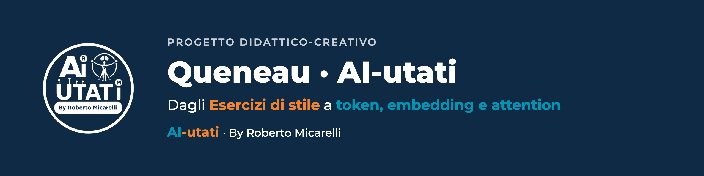

  

  
  
  

**Un'opera letteraria per capire come ragiona un modello linguistico.** Si parte dagli *Esercizi di stile* di Raymond Queneau, la stessa storia raccontata in modi diversi, e si arriva a token, embedding e attention, fino alla creatività aumentata e al pensiero critico.

## In 30 secondi

| Scheda | Dettaglio |
|---|---|
| **Cos'è** | Un'esperienza didattico-creativa in un solo file HTML |
| **Per chi** | Chi vuole capire l'AI generativa partendo da qualcosa di umano |
| **Come provarla** | [Apri la demo](https://queneau-aiutati-all-in-one.vercel.app) o scarica `index.html` e aprilo nel browser |

## Cosa trovi dentro

| Elemento | Dettaglio |
|---|---|
| Cinema in sette atti | Il percorso principale, dall'inizio alla fine |
| 25 voci ElevenLabs | Le voci che raccontano e interpretano i testi |
| Immagini e laboratori interattivi | Per provare i concetti, non solo leggerli |
| Manifesto finale | La sintesi del percorso |
| Making-of della regia | Come è stato costruito |

## Come si usa

1. **In rete:** apri la [demo](https://queneau-aiutati-all-in-one.vercel.app).
2. **In locale:** scarica `index.html` e aprilo con Chrome, Edge o Safari. Non serve nessun server e non carica risorse multimediali esterne: tutto è incorporato nel file.
3. **Online sul tuo spazio:** la cartella è pronta per GitHub Pages e Vercel.

## Perché esiste

È un progetto **AI-utati**: l'AI si capisce meglio quando parte da un'opera umana. Qui la parte umana è la letteratura, la parte AI è il meccanismo che sta sotto un modello linguistico. La formula del metodo è `HI+AI=AI(Fluency)`.

Il racconto di come è nato è sul sito: [L'idea Queneau](https://www.ai-utati.it/risorse/idea-queneau/).

---

**AI-utati** · By Roberto Micarelli · Formatore, Coach, Consulente · [ai-utati.it](https://www.ai-utati.it) · [Scheda sul sito](https://www.ai-utati.it/risorse/idea-queneau/) · [Tutti i progetti](https://github.com/RobertoMicarelli/brand-ai-utati)

**Provalo ora:** apri la demo e percorri i sette atti dall'inizio.
